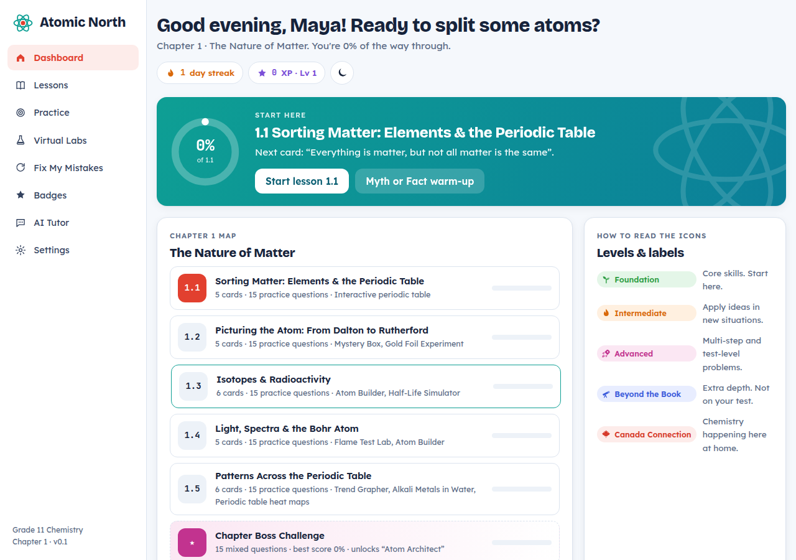
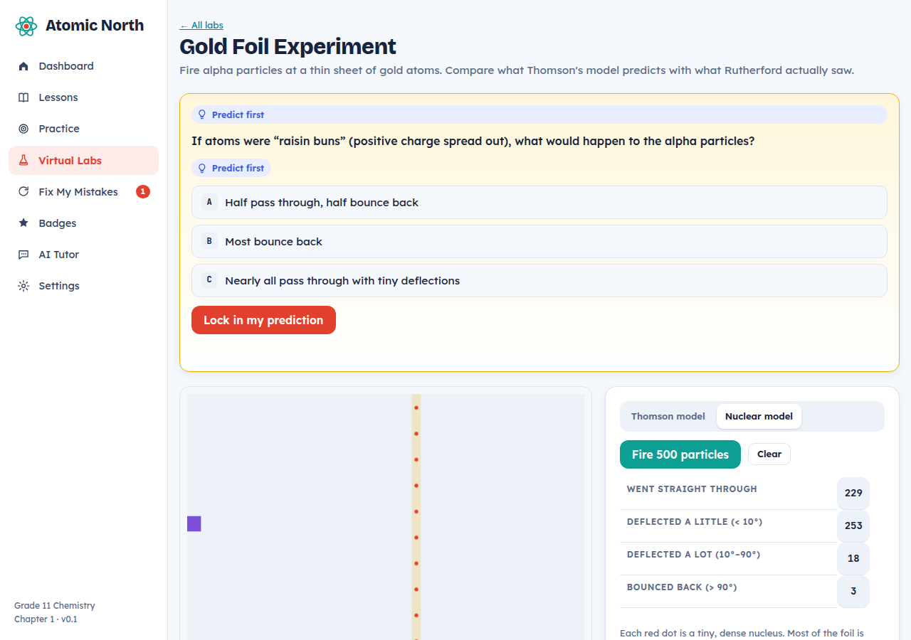
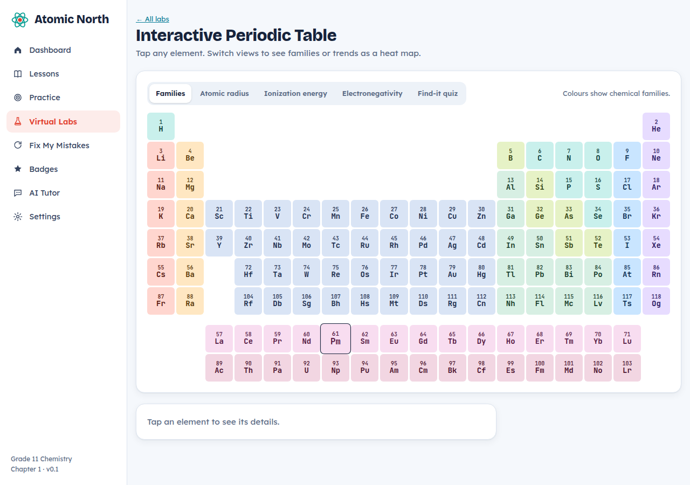

<div dir="rtl">

<p align="center"></p>

<h1 align="center">اتمیک نورث (Atomic North)</h1>
<p align="center"><b>همراه آموزشی تعاملی شیمی پایه‌ی یازدهم برای دانش‌آموزان کانادا</b><br>
فصل اول: <i>ماهیت ماده</i> · مطابق برنامه‌ی درسی SCH3U انتاریو · زبان برنامه: انگلیسی کانادایی</p>

<p align="center"><a href="README.md">English</a> · <b>فارسی</b></p>

<p align="center">
<a href="https://raminabiri.github.io/atomic-north-chem11/"><b>▶ باز کردن در مرورگر</b></a> &nbsp;·&nbsp;
<a href="https://github.com/raminabiri/atomic-north-chem11/releases/latest"><b>⬇ دانلود نسخه‌ی ویندوز</b></a>
</p>



---

## فهرست
- [شروع در ۳۰ ثانیه](#شروع-در-۳۰-ثانیه)
- [چه چیزی این برنامه را متفاوت می‌کند](#چه-چیزی-این-برنامه-را-متفاوت-میکند)
- [محتوای فصل اول](#محتوای-فصل-اول)
- [معنی آیکون‌ها](#معنی-آیکونها)
- [معلم هوش مصنوعی (اختیاری)](#معلم-هوش-مصنوعی-اختیاری)
- [برای معلم‌ها و والدین](#برای-معلمها-و-والدین)
- [حریم خصوصی](#حریم-خصوصی)
- [پرسش‌های رایج](#پرسشهای-رایج)
- [برای برنامه‌نویس‌ها](#برای-برنامهنویسها)
- [برنامه‌ی آینده](#برنامهی-آینده)
- [مجوز و سلب مسئولیت](#مجوز-و-سلب-مسئولیت)

---

## شروع در ۳۰ ثانیه

### روش اول: استفاده در مرورگر (پیشنهادی)
این لینک را باز کنید: **https://raminabiri.github.io/atomic-north-chem11/**
روی کامپیوتر، کروم‌بوک، آیپد و گوشی، در هر مرورگری کار می‌کند و به نصب هیچ چیزی نیاز ندارد.

### روش دوم: نصب روی ویندوز
1. به صفحه‌ی [آخرین نسخه](https://github.com/raminabiri/atomic-north-chem11/releases/latest) بروید.
2. یکی از این دو فایل را دانلود کنید:
   - **`AtomicNorth-Setup-x.y.z.exe`**: برنامه را نصب می‌کند و میان‌بر آن را به منوی استارت اضافه می‌کند.
   - **`AtomicNorth-Portable-x.y.z.exe`**: بدون نصب، مستقیم اجرا می‌شود. برای فلش یا کامپیوتر مدرسه مناسب است.
3. چون برنامه هنوز امضای دیجیتال ندارد، ممکن است ویندوز پیام **«ویندوز از رایانه‌ی شما محافظت کرد»** نشان دهد. روی **More info** و بعد **Run anyway** بزنید.

بار اول برنامه نام کوچک دانش‌آموز را می‌پرسد و اینکه توضیح‌ها را در چه سطحی دوست دارد. همین.

---

## چه چیزی این برنامه را متفاوت می‌کند

| ایده | چطور کار می‌کند |
|---|---|
| **اول فکر کن** | بسیاری از کارت‌های درس با یک سؤال «اول پیش‌بینی کن» شروع می‌شوند. توضیح فقط بعد از حدس زدن باز می‌شود. |
| **جواب باید به دست بیاید** | راه‌حل کامل فقط وقتی باز می‌شود که دانش‌آموز درست جواب بدهد یا دو بار واقعاً تلاش کند. اول راهنمایی می‌آید. |
| **بازخورد برای اشتباه خود تو** | برای جواب‌های غلط رایج توضیح اختصاصی می‌آید، مثلاً «۳۷ مجموع پروتون‌ها و نوترون‌هاست، پروتون‌ها را کم کن». نه فقط «غلط است». |
| **سه سطح توضیح** | هر کارت بین «ساده‌تر»، «معمولی» و «عمیق‌تر» عوض می‌شود. هم برای دانش‌آموزی که مشکل دارد مناسب است، هم برای دانش‌آموزی که چالش می‌خواهد. |
| **میزان اطمینان** | قبل از بررسی جواب، دانش‌آموز می‌گوید چقدر مطمئن است. حدس‌های شانسی وارد بخش مرور می‌شوند. |
| **مرور فاصله‌دار** | بخش «رفع اشتباه‌ها» سؤال‌های غلط را بعد از ۱، ۳ و ۷ روز دوباره می‌پرسد. |
| **بلند خواندن** | هر کارت با صدای انگلیسی کانادایی خوانده می‌شود، اگر دستگاه آن را داشته باشد. |
| **ساخته‌شده برای کانادا** | املای کانادایی و مثال‌های کانادایی: رآکتورهای کندو، نیکل سادبری، پتاس ساسکاچوان، شفق قطبی، آتش‌بازی روز کانادا و کارهای رادرفورد در دانشگاه مک‌گیل. |

---

## محتوای فصل اول

### درس‌ها: ۵ بخش و ۲۸ کارت تعاملی
| بخش | موضوع‌ها |
|---|---|
| **۱.۱ دسته‌بندی ماده** | ماده‌ی خالص و مخلوط، عنصر و ترکیب، آزمون‌های تشخیصی، فلز و نافلز و شبه‌فلز، شرایط استاندارد، تاریخچه‌ی جدول تناوبی و قانون تناوبی، گروه‌ها و دوره‌ها و خانواده‌ها، نماد عنصرها و نام‌گذاری آیوپاک |
| **۱.۲ تصویر اتم** | دانش تجربی و نظری، مدل‌ها، قانون پایستگی جرم و نسبت‌های ثابت، دالتون، تامسون، رادرفورد، ذرات زیراتمی |
| **۱.۳ ایزوتوپ‌ها و پرتوزایی** | عدد اتمی و عدد جرمی، ایزوتوپ، جرم اتمی میانگین وزنی، پرتوهای آلفا و بتا و گاما، نیمه‌عمر، کاربردها و خطرهای رادیوایزوتوپ‌ها |
| **۱.۴ نور، طیف‌ها و اتم بور** | طیف پیوسته و خطی، آزمون شعله، ترازهای انرژی بور، نمودار ترازهای انرژی، الکترون‌های ظرفیت، ابر الکترونی |
| **۱.۵ الگوهای جدول تناوبی** | شعاع اتمی، یون‌ها، انرژی یونش، الکترون‌خواهی، الکترونگاتیوی، روند واکنش‌پذیری |

**۷ مثال حل‌شده‌ی قدم‌به‌قدم** دارد که هر قدمش فقط بعد از تلاش خود دانش‌آموز باز می‌شود. هر بخش هم با تمرین «برای یک دوست توضیح بده» تمام می‌شود.

### خلاصه‌ی فصل، ۷۳ اصطلاح کلیدی و کارت‌های مرور
مرور یک‌صفحه‌ای همه‌ی بخش‌ها، رابطه‌های کلیدی (مثل تعداد نوترون و فرمول نیمه‌عمر)، واژه‌نامه‌ی قابل جست‌وجو و حالت کارت مرور.

### تمرین‌ها: ۷۸ سؤال
از هر بخش ۱۵ تا ۱۸ سؤال، در سه سطح و پنج نوع: چندگزینه‌ای، عددی همراه با واحد، دسته‌بندی، مرتب‌کردن و پاسخ تشریحی (با پاسخ نمونه و فهرست خودارزیابی).

### ۹ آزمایشگاه مجازی
| آزمایشگاه | چه کاری می‌کنید |
|---|---|
| **عنصر یا ترکیب؟** | هفت نمونه را گرم کنید یا از آن‌ها جریان برق بگذرانید و بعد دسته‌بندی‌شان کنید (مراقب واکنش با هوا باشید!) |
| **جدول تناوبی تعاملی** | گشتن در خانواده‌ها، نقشه‌ی رنگی شعاع و انرژی یونش و الکترونگاتیوی، و بازی «پیدایش کن» |
| **جعبه‌ی اسرارآمیز** | با پرتاب تیله شکل پنهان داخل جعبه را کشف کنید، همان روشی که دانشمندان برای مدل‌سازی اتم به کار بردند |
| **ورقه‌ی طلا** | مقایسه‌ی مدل تامسون با مدل هسته‌ای رادرفورد |
| **اتم‌ساز** | با پروتون و نوترون و الکترون اتم و ایزوتوپ و یون بسازید و چالش‌ها را حل کنید |
| **شبیه‌ساز نیمه‌عمر** | واپاشی ۴۰۰ هسته را ببینید و بعد خودتان نیمه‌عمر را با پرتاب ۱۰۰ سکه مدل کنید |
| **آزمون شعله** | هفت ترکیب فلزی را آزمایش کنید و بعد چهار نمونه‌ی ناشناس را شناسایی کنید |
| **رسم روندها** | اول الگو را پیش‌بینی کنید، بعد نمودار عناصر ۱ تا ۳۶ را ببینید |
| **فلزات قلیایی در آب** | اول ترتیب واکنش‌پذیری را پیش‌بینی کنید، بعد واکنش لیتیم تا سزیم را ببینید |

<p align="center"> </p>

### بازی و انگیزه
- **افسانه یا واقعیت؟**: ۱۸ جمله‌ی کوتاه درباره‌ی اتم
- **چالش پایانی فصل**: ۱۵ سؤال ترکیبی، ۳ جان، با زمان‌سنج ۲۰ دقیقه‌ای اختیاری
- **امتیاز، سطح و روزهای پیاپی**
- **۱۸ نشان** و **کارت‌های عناصر قابل جمع‌آوری** (هر ۶۰ امتیاز یک کارت تازه)

---

## معنی آیکون‌ها

| آیکون | معنی |
|---|---|
| 🌱 **مقدماتی** | مهارت‌های پایه. از اینجا شروع کنید. |
| 🔥 **متوسط** | به کار بردن مفاهیم در موقعیت‌های تازه. |
| 🚀 **پیشرفته** | مسئله‌های چندمرحله‌ای در سطح امتحان. |
| 🔭 **فراتر از کتاب** | مطالب بالاتر از سطح درس. جالب است، ولی در امتحان نمی‌آید. |
| 🍁 **ارتباط با کانادا** | شیمی در زندگی روزمره‌ی کانادا. |

---

## معلم هوش مصنوعی (اختیاری)

برنامه بدون هوش مصنوعی هم کامل کار می‌کند. اگر دانش‌آموز یا والدین کمک بیشتری بخواهند، می‌توانند کلید شخصی خودشان را وصل کنند:

1. در سایت **console.anthropic.com** حساب بسازید و چند دلار اعتبار اضافه کنید.
2. یک **کلید** بسازید.
3. در برنامه به **Settings → AI Tutor** بروید، کلید را وارد کنید و **Save & test** را بزنید.

بعد از آن معلم هوش مصنوعی:
- **پاسخ‌های تشریحی را از ۳ نمره تصحیح می‌کند** و بازخورد دقیق می‌دهد.
- **درباره‌ی هر موضوع فصل اول گفت‌وگو می‌کند.** اول راهنمایی می‌کند تا فکر کردن با خود دانش‌آموز باشد.

مدل را می‌شود در تنظیمات انتخاب کرد: بهترین کیفیت (Opus 5.5)، متعادل (Sonnet 5.5) یا ارزان‌ترین (Haiku 5.5). **هزینه‌ی استفاده با صاحب کلید است.**

---

## برای معلم‌ها و والدین

- **بدون ثبت‌نام و بدون حساب کاربری.** دانش‌آموز فقط لینک را باز می‌کند.
- **مناسب برای:** پیش‌مطالعه قبل از کلاس، تمرین در خانه، مرور قبل از امتحان (چالش پایانی با زمان‌سنج) و جبران جلسه‌های غیبت.
- **دانش‌آموز ضعیف‌تر** می‌تواند روی سطح «ساده‌تر» بماند، از «بلند خواندن» استفاده کند و سؤال‌های 🌱 را حل کند.
- **دانش‌آموز قوی‌تر** می‌تواند از «عمیق‌تر»، سؤال‌های 🚀 و کادرهای 🔭 استفاده کند.
- **انتقال پیشرفت:** در تنظیمات با «Copy progress code» یک کد ساخته می‌شود که روی دستگاه دیگر قابل استفاده است.

---

## حریم خصوصی

- پیشرفت دانش‌آموز **فقط روی دستگاه خودش** ذخیره می‌شود. سرور، ردیابی و آمارگیری وجود ندارد.
- اگر معلم هوش مصنوعی فعال باشد، کلید فقط روی همان دستگاه ذخیره می‌شود و همراه با سؤال یا پاسخ دانش‌آموز فقط به شرکت Anthropic فرستاده می‌شود.
- نسخه‌ی وب قلم‌ها را از Google Fonts بارگذاری می‌کند.

---

## پرسش‌های رایج

**بدون اینترنت کار می‌کند؟**
نسخه‌ی ویندوز بله (در این حالت از قلم خود ویندوز استفاده می‌کند). نسخه‌ی وب برای بار اول به اینترنت نیاز دارد.

**روی مک، آیپد یا گوشی کار می‌کند؟**
بله، از طریق لینک مرورگر. اپ‌های اختصاصی آی‌او‌اس و اندروید در برنامه‌ی آینده هستند.

**پیشرفتم کجا ذخیره می‌شود؟**
روی همان دستگاهی که استفاده می‌کنید. پاک کردن اطلاعات مرورگر آن را پاک می‌کند، پس از «Copy progress code» نسخه‌ی پشتیبان بگیرید.

**این خود کتاب درسی است؟**
خیر. یک همراه آموزشی مستقل است. همه‌ی توضیح‌ها، سؤال‌ها و شکل‌ها تازه نوشته و ساخته شده‌اند و با برنامه‌ی درسی SCH3U انتاریو هماهنگ‌اند.

**اشکالی دیدم یا پیشنهادی دارم.**
لطفاً در بخش [Issues](https://github.com/raminabiri/atomic-north-chem11/issues) بنویسید.

---

## برای برنامه‌نویس‌ها

برنامه با HTML و CSS و جاوااسکریپت ساده نوشته شده و به ساختن (build) یا فریم‌ورک نیازی ندارد.

<div dir="ltr">

```
app/
  index.html            app shell and icon set
  css/app.css           styles (light and soft-dark themes)
  js/data.js            element data, flame colours, isotopes
  js/figures.js         SVG charts and diagrams drawn in code
  js/content-ch1.js     Chapter 1 cards, questions and myths
  js/core.js            state, XP, badges, review deck, router
  js/widgets.js         interactive question widget
  js/labs.js            the 8 virtual labs
  js/ai.js              optional Claude tutor
  js/views.js           pages
electron/main.js        Windows/desktop wrapper
.github/workflows/      GitHub Pages deploy + Windows build
```

</div>

| کار | دستور |
|---|---|
| اجرا در مرورگر | باز کردن `app/index.html` |
| اجرا به‌صورت برنامه‌ی دسکتاپ | `npm install` و بعد `npm start` |
| ساخت فایل نصبی ویندوز | `npm run dist:win` |
| انتشار نسخه‌ی تازه | فرستادن یک برچسب مثل `v0.1.1`. گیت‌هاب خودش هر دو فایل exe را می‌سازد و در صفحه‌ی انتشار می‌گذارد. |

هر تغییری در پوشه‌ی `app/` روی شاخه‌ی اصلی به‌طور خودکار روی سایت منتشر می‌شود.

---

## برنامه‌ی آینده
- [x] فصل اول: ماهیت ماده
- [ ] جمع‌آوری نظر دانش‌آموزان و معلم‌ها
- [ ] فصل‌های بعدی
- [ ] اپ آی‌او‌اس و اندروید (با همین کد)
- [ ] قرار دادن قلم‌ها داخل برنامه برای کار کامل بدون اینترنت
- [ ] صفحه‌ی پیگیری پیشرفت برای معلم و والدین

---

## مجوز و سلب مسئولیت

کد و محتوا تحت مجوز **MIT** است، © ۲۰۲۶ رامین ابیری. متن کامل در فایل [LICENSE](LICENSE) است.

اتمیک نورث یک کمک‌آموزشی مستقل است و **هیچ وابستگی یا تأییدی از طرف ناشران کتاب درسی یا هیئت‌های آموزشی ندارد**. جای معلم، کتاب درسی و آموزش ایمنی آزمایشگاه واقعی را نمی‌گیرد.

</div>
