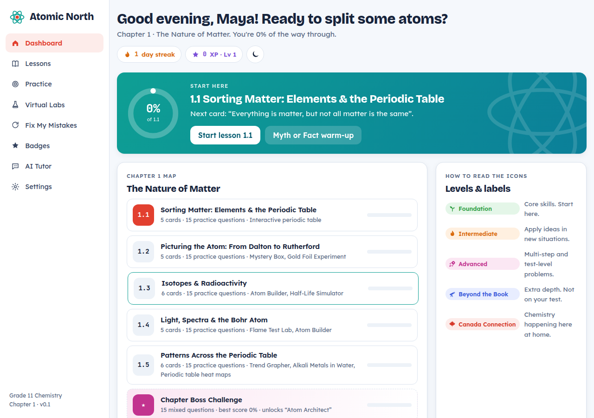
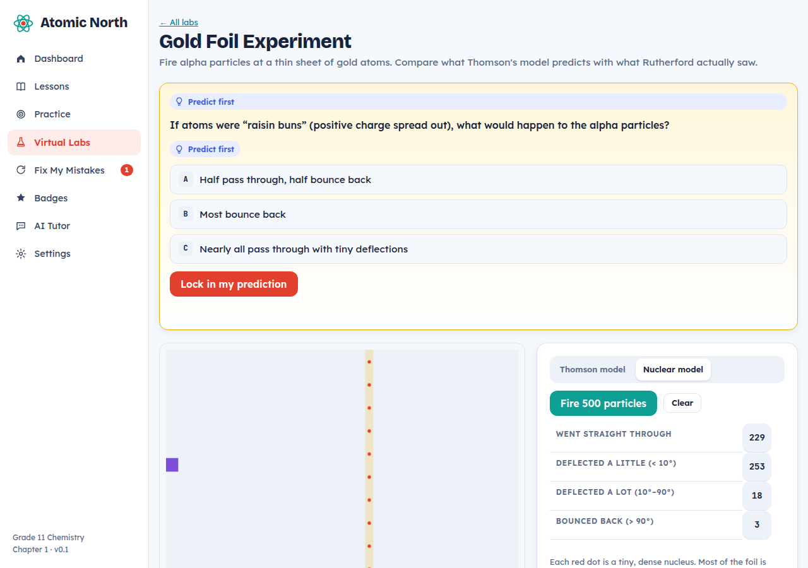
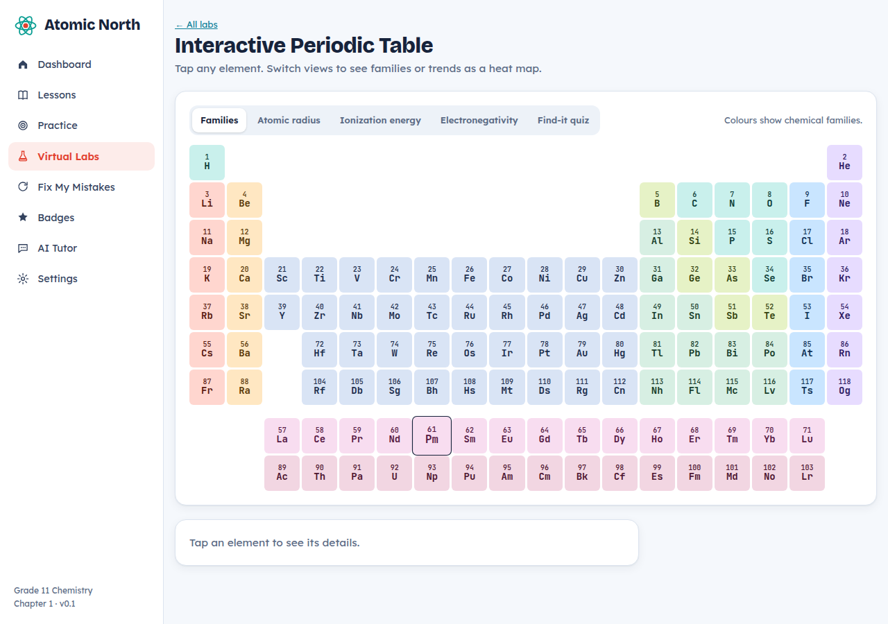

<p align="center"></p>

<h1 align="center">Atomic North</h1>
<p align="center"><b>An interactive Grade 11 Chemistry companion for Canadian students</b><br>
Chapter 1: <i>The Nature of Matter</i> · Ontario SCH3U curriculum · Canadian English</p>

<p align="center"><b>English</b> · <a href="README.fa.md">فارسی</a></p>

<p align="center">
<a href="https://raminabiri.github.io/atomic-north-chem11/"><b>▶ Open in your browser</b></a> &nbsp;·&nbsp;
<a href="https://github.com/raminabiri/atomic-north-chem11/releases/latest"><b>⬇ Download for Windows</b></a>
</p>



---

## Contents
- [Get started in 30 seconds](#get-started-in-30-seconds)
- [What makes it different](#what-makes-it-different)
- [What's in Chapter 1](#whats-in-chapter-1)
- [The icons](#the-icons)
- [The optional AI Tutor](#the-optional-ai-tutor)
- [For teachers and parents](#for-teachers-and-parents)
- [Privacy](#privacy)
- [FAQ](#faq)
- [For developers](#for-developers)
- [Roadmap](#roadmap)
- [Licence and disclaimer](#licence-and-disclaimer)

---

## Get started in 30 seconds

### Option 1: Use it in your browser (recommended)
Open **https://raminabiri.github.io/atomic-north-chem11/**. It works in Chrome, Edge, Firefox and Safari on a computer, Chromebook, iPad or phone, with nothing to install.

### Option 2: Install it on Windows
1. Go to the [latest release](https://github.com/raminabiri/atomic-north-chem11/releases/latest).
2. Download one of these:
   - **`AtomicNorth-Setup-x.y.z.exe`**: installs the app with a Start-menu shortcut.
   - **`AtomicNorth-Portable-x.y.z.exe`**: runs straight away, no installation (good for USB sticks or school computers).
3. Windows may show **"Windows protected your PC"** because the app isn't code-signed yet. Click **More info**, then **Run anyway**.

The first time you open it, you enter your first name and pick how you like things explained. That's it.

---

## What makes it different

| Idea | How it works |
|---|---|
| **You think first** | Many lesson cards start with a *Predict first* question. The explanation opens only after you commit to a guess. |
| **Answers are earned** | The full solution unlocks only after you get it right or make two real attempts. Hints come first. |
| **Feedback on *your* mistake** | Common wrong answers get a specific explanation, like "37 is the total of protons and neutrons, so take the protons out". You don't just see "wrong". |
| **Three explanation levels** | Every card can switch between *Explain it simpler*, *Standard* and *Go deeper*. It works for students who are struggling and students who want a challenge. |
| **Confidence check** | Before checking an answer, you say how sure you are. Lucky guesses go into your review deck so they don't fool you twice. |
| **Spaced review** | *Fix My Mistakes* brings back missed questions after 1, 3 and 7 days until you've really got them. |
| **Listen mode** | Every card can be read aloud in a Canadian English voice (where the device has one). |
| **Made for Canada** | Canadian spelling and examples: CANDU reactors, Sudbury nickel, Saskatchewan potash, northern lights, Canada Day fireworks, and Rutherford's work at McGill. |

---

## What's in Chapter 1

### Lessons: 5 sections, 27 interactive cards
| Section | Topics |
|---|---|
| **1.1 Sorting Matter** | pure substances and mixtures, elements and compounds, diagnostic tests, metals/nonmetals/metalloids, history of the periodic table, groups, periods and families |
| **1.2 Picturing the Atom** | empirical and theoretical knowledge, models, the laws of conservation of mass and constant composition, Dalton, Thomson, Rutherford, subatomic particles |
| **1.3 Isotopes & Radioactivity** | atomic number and mass number, isotopes, weighted atomic mass, alpha/beta/gamma radiation, half-life, uses and risks of radioisotopes |
| **1.4 Light, Spectra & the Bohr Atom** | continuous and line spectra, flame tests, Bohr energy levels, energy-level diagrams, valence electrons, the electron cloud |
| **1.5 Patterns Across the Periodic Table** | atomic radius, ions, ionization energy, electron affinity, electronegativity, reactivity trends |

Each section ends with an **"Explain it to a friend"** task, a good way to check that you really understand.

### Practice: 75 questions
Fifteen per section, at three levels, in five formats: multiple choice, numeric (with units), sort-into-groups, put-in-order and written answers (with a model answer and a self-check list).

### 8 virtual labs
| Lab | What you do |
|---|---|
| **Interactive Periodic Table** | Explore families, see heat maps of radius, ionization energy and electronegativity, and play a find-it quiz |
| **Mystery Box** | Fire marbles at a hidden shape and work out what it is, the same way scientists modelled the atom |
| **Gold Foil Experiment** | Compare Thomson's model with Rutherford's nuclear model |
| **Atom Builder** | Add protons, neutrons and electrons to build atoms, isotopes and ions, with challenges |
| **Half-Life Simulator** | Watch 400 nuclei decay and compare with the perfect halving curve |
| **Flame Test Lab** | Test seven metal compounds, then identify four unknowns |
| **Trend Grapher** | Predict the pattern, then graph trends for elements 1–36 |
| **Alkali Metals in Water** | Predict the reactivity order, then watch Li → Cs react |

<p align="center"> </p>

### Games and motivation
- **Myth or Fact?**: 18 quick statements about atoms
- **Chapter Boss Challenge**: 15 mixed questions, 3 lives, optional 20-minute timer
- **XP, levels and a daily streak**
- **18 badges** and **collectable element cards** (one new card every 60 XP)

---

## The icons

| Icon | Meaning |
|---|---|
| 🌱 **Foundation** | Core skills. Start here. |
| 🔥 **Intermediate** | Apply ideas in new situations. |
| 🚀 **Advanced** | Multi-step and test-level problems. |
| 🔭 **Beyond the Book** | Extra depth, above the course level. Interesting, but not on your test. |
| 🍁 **Canada Connection** | Chemistry happening here at home. |

---

## The optional AI Tutor

Atomic North works fully without AI. If a student (or parent) wants extra help, they can connect their **own** Claude API key:

1. Create an account at **console.anthropic.com** and add a few dollars of credit.
2. Create an **API key**.
3. In Atomic North, open **Settings → AI Tutor**, paste the key, and press **Save & test**.

Then the tutor can:
- **mark written answers** out of 3, with specific feedback
- **chat** about anything in Chapter 1. It gives hints first, so the student still does the thinking.

You can choose the model in Settings: *Claude Opus 5.5* (best quality), *Sonnet 5.5* (balanced) or *Haiku 5.5* (cheapest). **All usage is billed to the key owner's account.**

---

## For teachers and parents

- **No accounts and no sign-up.** Students just open the link.
- **Good for:** preview before class, homework practice, test review (Boss Challenge with timer), and catching up after an absence.
- **Students who are struggling** can stay on *Explain it simpler*, use *Listen*, and stick to 🌱 questions.
- **Strong students** can use *Go deeper*, the 🚀 questions and the 🔭 boxes.
- **Moving progress:** Settings → *Copy progress code* produces a code that can be pasted on another device.

---

## Privacy

- Progress is stored **only on the student's own device** (browser storage or the Windows app). There is no server, no tracking and no analytics.
- If the AI Tutor is used, the key is stored only on that device and is sent only to Anthropic, together with the student's question or answer.
- The web version loads fonts from Google Fonts.

---

## FAQ

**Does it work offline?**
The Windows app works offline (fonts fall back to the system font). The web version needs the internet to load the first time.

**Does it work on a Mac, iPad or phone?**
Yes, through the browser link. Native iOS and Android apps are on the roadmap.

**Where is my progress saved?**
On the device you use. Clearing browser data erases it, so use *Copy progress code* as a backup.

**Is this the textbook?**
No. It's an independent study companion. All explanations, problems and figures are original and written to match the Ontario SCH3U curriculum.

**I found a mistake or have an idea.**
Please open an [issue](https://github.com/raminabiri/atomic-north-chem11/issues).

---

## For developers

Plain HTML, CSS and JavaScript, with no build step and no framework.

```
app/
  index.html            app shell and icon set
  css/app.css           styles (light and soft-dark themes)
  js/data.js            element data, flame colours, isotopes
  js/figures.js         SVG charts and diagrams drawn in code
  js/content-ch1.js     Chapter 1 cards, questions and myths
  js/core.js            state, XP, badges, review deck, router
  js/widgets.js         interactive question widget
  js/labs.js            the 8 virtual labs
  js/ai.js              optional Claude tutor
  js/views.js           pages
electron/main.js        Windows/desktop wrapper
.github/workflows/      GitHub Pages deploy + Windows build
```

| Task | Command |
|---|---|
| Run in a browser | open `app/index.html` |
| Run as a desktop app | `npm install` then `npm start` |
| Build a Windows installer | `npm run dist:win` |
| Publish a release | push a tag such as `v0.1.1`; GitHub Actions builds both `.exe` files and attaches them to a release |

Changes to `app/` on `main` are deployed to GitHub Pages automatically.

---

## Roadmap
- [x] Chapter 1: The Nature of Matter
- [ ] Feedback round with students and teachers
- [ ] More chapters
- [ ] iOS and Android apps (the same code wrapped with Capacitor)
- [ ] Bundled fonts for fully offline use
- [ ] Teacher/parent progress view

---

## Licence and disclaimer

Code and content: **MIT** © 2026 Ramin Abiri. See [LICENSE](LICENSE).

Atomic North is an independent study aid. It is **not affiliated with or endorsed by any textbook publisher or school board**. It doesn't replace your teacher, your textbook or real lab safety training.
